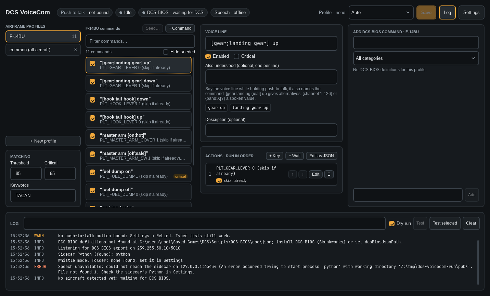

# DCS VoiceCom

Standalone, DCS-only voice control that replaces VoiceAttack for DCS World. Push a HOTAS button, speak,
and the command acts on the cockpit through [DCS-BIOS (Skunkworks)](https://github.com/DCS-Skunkworks/dcs-bios),
with keyboard shortcuts as a fallback. Speech runs in the app on the CPU with [Cactus Whistle](https://huggingface.co/Cactus-Compute/whistle);
nothing leaves the machine.

Free and open source under the [GNU General Public License v3.0 or later](LICENSE). See [Licence](#licence) and
[THIRD-PARTY-NOTICES.md](THIRD-PARTY-NOTICES.md).

## How it fits together

```
HOTAS button ──DirectInput──► .NET app: mic (WASAPI) → Whistle (libneedle, in process) → phrase matcher → engine
                                │  ▲
             UDP 7778 "ID ARG"  │  │  UDP multicast 239.255.50.10:5010 (binary export)
                                ▼  │
                          DCS-BIOS inside DCS
```

1. PTT down → the app keeps the microphone's audio, starting 200 ms before the press.
2. PTT up → Whistle transcribes the clip, biased towards the active profile's words, and the matcher scores it
   against the profile's phrases: phrase, score, slot words, raw text, runner-up candidates, and a reject reason
   when a word wasn't heard or two commands are too close to call.
3. The app parses spoken values, checks the threshold (85, or 95 for commands flagged critical) and the command's conditions against live DCS-BIOS state.
4. It runs the steps: DCS-BIOS lines, scan-code key presses, waits on cockpit state.
5. It plays an audio cue (accepted / no match / refused) and logs the result.

The app follows `_ACFT_NAME` from the export stream and loads that aircraft's profile; a profile can be pinned instead.

## Install

Run `DcsVoiceCom-Setup-<version>.exe`. It needs no admin rights and no .NET install (the app is self-contained),
installs the sample profiles, and adds a Start menu entry. DCS-BIOS must be installed in DCS.

To build the installer on Windows (needs the .NET 10 SDK and [Inno Setup 6](https://jrsoftware.org/isinfo.php)):

```
powershell -ExecutionPolicy Bypass -File installer\build.ps1
```

It writes `dist\DcsVoiceCom-Setup-<version>.exe`. The **Installer** workflow in GitHub Actions builds it too
(run it by hand, or push a `v*` tag). A `v*` tag sets the version: `v0.1.0-beta.5` builds `DcsVoiceCom-Setup-0.1.0-beta.5.exe`. Local builds and manual runs use `<Version>` in `Directory.Build.props` (`0.1.0-dev`); `build.ps1 -Version 0.1.0-beta.5` overrides it.

To publish a release, add notes as `docs/releases/<tag>.md`, then push the tag (for example `v0.1.0-beta.1`). The
workflow builds the installer and creates the GitHub release with it; a tag with a `-` becomes a pre-release.

Or build and run the app from the checkout without installing:

```
dotnet publish src\DcsVoiceCom.App -c Release -r win-x64 --self-contained false -o dist\DcsVoiceCom
dist\DcsVoiceCom\DcsVoiceCom.exe
```

The Whistle model and engine are bundled, so speech works offline. Full steps, settings and troubleshooting:
[docs/windows-setup.md](docs/windows-setup.md). A tour of the window: [docs/app.md](docs/app.md).

Note: Old screenshot needs to be updated.


## Still missing

- A run against DCS, which should also confirm the F-14B's `_ACFT_NAME` is `F-14BU` (the sample profile assumes it).

## Repository layout

| Path | What |
|---|---|
| `src/DcsVoiceCom.Core` | Platform-neutral core (net10.0): DCS-BIOS client and export parser, definition loader, profiles, phrase/slot/number parsing, command engine, speech (Whistle binding, phrase matcher, model download), runtime wiring |
| `src/DcsVoiceCom.Windows` | Windows adapters: DirectInput push-to-talk, WASAPI microphone, `SendInput` scan-code keys, WAV cues |
| `src/DcsVoiceCom.Host` | Console host: the full voice loop without UI |
| `src/DcsVoiceCom.ViewModels` | UI logic (net10.0, tested on any OS): profiles, command editor, control browser, test panel, log, settings |
| `src/DcsVoiceCom.App` | The WPF app (`DcsVoiceCom.exe`): main window, Settings, tray icon with profile override |
| `model/cactus-needle` | Whistle weights and the needle engine (Windows DLL, Linux .so for tests), Apache-2.0 |
| `profiles/` | Sample profiles: `F-14BU.json` (F-14B Upgraded), `common.json` |
| `tests/` | xUnit tests for the core and the view models |
| `assets/cues` | Default cue sounds (generated by `tools/make_cues.py`) |
| `installer/` | Inno Setup script and `build.ps1` for the Windows installer |
| `docs/` | [Windows setup](docs/windows-setup.md), [the app](docs/app.md), [profile format](docs/profiles.md) |

## Build and test

Requires the .NET 10 SDK.

```
dotnet build
dotnet test
```

The Windows projects target `net10.0-windows` and build on Linux too (`EnableWindowsTargeting`), but only run on Windows.
It needs the .NET 10 SDK (`global.json` pins it). Microsoft's SDK from dotnet.microsoft.com or
`actions/setup-dotnet` works, and so does Ubuntu's `dotnet-sdk-10.0`.

A test runs 30 recorded commands through the real Whistle engine on every build. The WPF app can be run and
screenshotted on Linux under Wine; see `.claude/skills/run-dcs-voicecom`.

## Licence

Copyright 2026 nicelifeBS. DCS VoiceCom is free software, licensed under the
[GNU General Public License v3.0 or later](LICENSE) (SPDX: `GPL-3.0-or-later`).

- **You may** use, study, change, and share the app, including for commercial purposes.
- **If you share it** (changed or not), you must give the full source code under the same licence and keep the
  copyright and licence notices.
- **No warranty.** The app is provided as is.

The licence covers the code, not the name. "DCS VoiceCom" and its logo are not licensed under the GPL: if you
share a changed version, give it a different name so people do not mistake it for the official app.

Third-party components keep their own licences; see [THIRD-PARTY-NOTICES.md](THIRD-PARTY-NOTICES.md).
