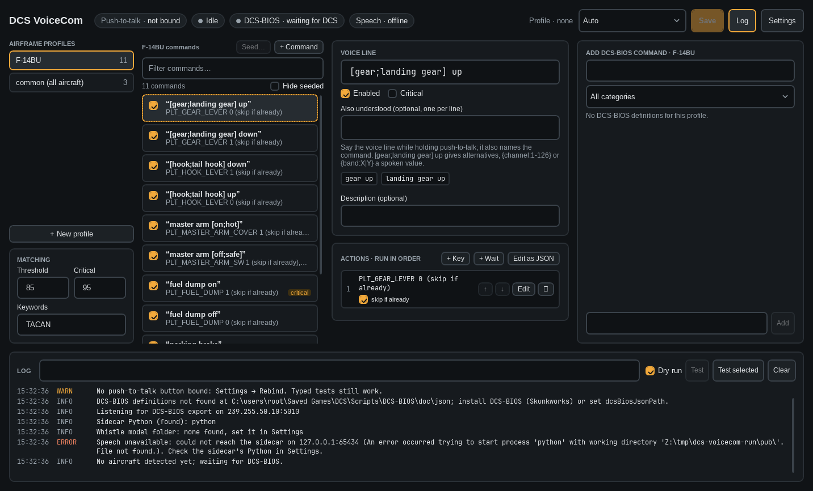
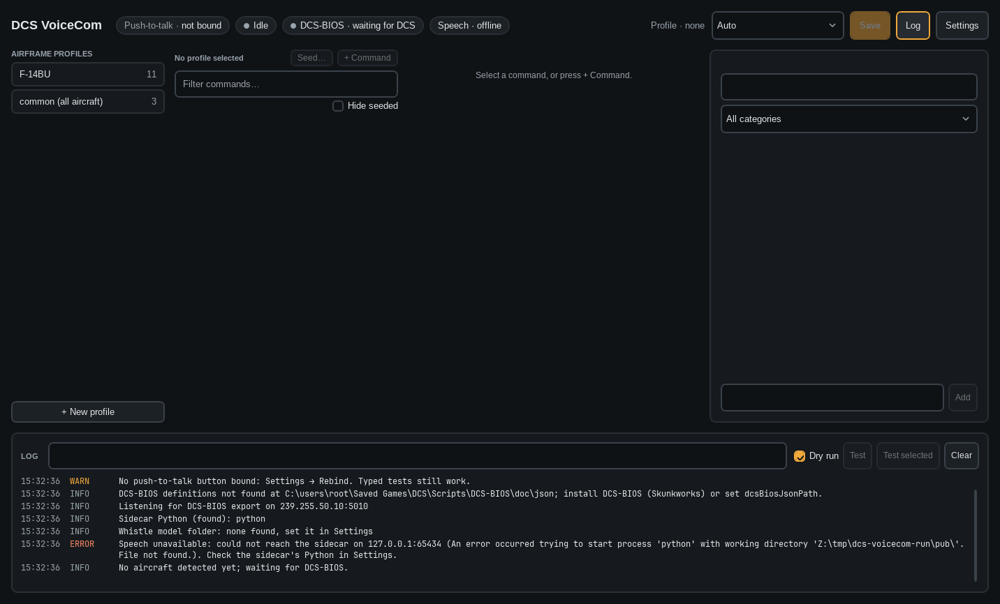

# The app

The app has its own help: click **Help** in the top bar or press F1. Its pages are in [docs/help](help/), and
they are the user guide. This page is a short tour for developers.

The window follows the [UI mockup](https://claude.ai/artifact/Mpfk1gufrjqJuZPS88tqmr).

The screenshots were taken under Wine (see `../.claude/skills/run-dcs-voicecom`), so the fonts are close Linux
stand-ins, and DCS, DCS-BIOS definitions and speech are offline.

- **Top bar:** push-to-talk binding, Listening/Idle, DCS-BIOS and speech status, profile override (Auto or a
  pinned profile), Save (Ctrl+S), Log, Settings, Help (F1).
- **Airframe profiles:** one per `_ACFT_NAME`, plus `common` for all aircraft; the active one has a green dot.
  + New profile offers the aircraft DCS-BIOS knows, the one you are flying first. Threshold, critical threshold and
  keywords sit below the list.
- **Commands:** first phrase and steps per command, an Enabled box, critical and seeded badges, a filter box and
  *Hide seeded*. Right-click or Del deletes (after asking); Duplicate is in the same menu.
- **Seed…:** generates disabled starter commands from the aircraft's DCS-BIOS definitions, panel by panel, with a
  preview and search. See [Seeding](docs/profiles.md#seeding). *Remove seeded commands* (right-click) takes back the
  ones you have not edited or enabled.
- **Editor:** name, phrases (one per line, with `[a;b]` alternatives and `{slots}`), a preview of what they expand to,
  problems in red, Enabled/Critical, and the steps in order: reorder, edit, remove, *skip if already* on DCS-BIOS
  steps, + Key, + Wait, + Enter value, and *Edit as JSON* for `if`/`wait_for`/`bios_until`. Double-click a step to edit it.
- **Enter value window:** opens from an *enter value* step's Edit. Pick the spoken slot, the read-back display and
  *Switches / dials* or *Keypad*. The display shows cell by cell: click a character, Shift+click to widen, then make
  it a *Wheel*, the *Keypad* field or *Read-only*. Place and width come from where the field sits. For a wheel, pick
  its control, range (`0-9`, `22-39`, `X,Y`) and mode; ▲/▼ send one test click and learn which way it turns.
  *Fill from radio…* finds a radio's wheels and places them on the live display. *Learn from display…* (DCS running) lists
  the controls that might drive the display; tick them and press Start, and the app operates each once, watches the
  display and builds the wheels (or keys) and their ranges, then puts everything back. It only runs when you press it. *Try a spoken value* shows in green
  what each character will become. Setting up fields needs DCS running; without it the window shows a warning and
  empty cells, and the rest stays editable.
- **Add DCS-BIOS command:** search the aircraft's controls by words, filter by panel, see live values while DCS flies
  that aircraft, and click an argument (positions, INC/DEC, ±step, TOGGLE) to add a step. **BUTTON** (on two-state
  controls such as MFD buttons) adds one *button press* step: push in, hold, release. With no command selected
  this creates one, named and phrased after the control. A free-text argument (`{deg}`, `+1000`) goes in the box below.
- **Button press:** tick *button press* on any DCS-BIOS step to make it a click. Its *in* / *out* values (default 1 / 0)
  and *hold* time (default 50 ms) are editable right in the action row.
- **Log and test:** every push-to-talk and test with what was heard, the match, the score and the result. Type a phrase
  and press Enter (or *Test selected*); *Dry run* lists the steps without sending them.
- **Settings:** push-to-talk rebind, microphone, language, Whistle model folder, DCS-BIOS ports and
  definitions folder, profiles folder, key hold, cues. Saving restarts the voice engine.
- **Help:** the pages in `docs/help`, built into the exe: topics in groups, full-text search, links between pages,
  screenshots (click one to see it full size). It stays open beside the main window and keeps the last topic until
  the app quits.
- **Tray icon:** minimizing hides the window to the tray; its menu pins a profile or returns to Auto, and quits.
