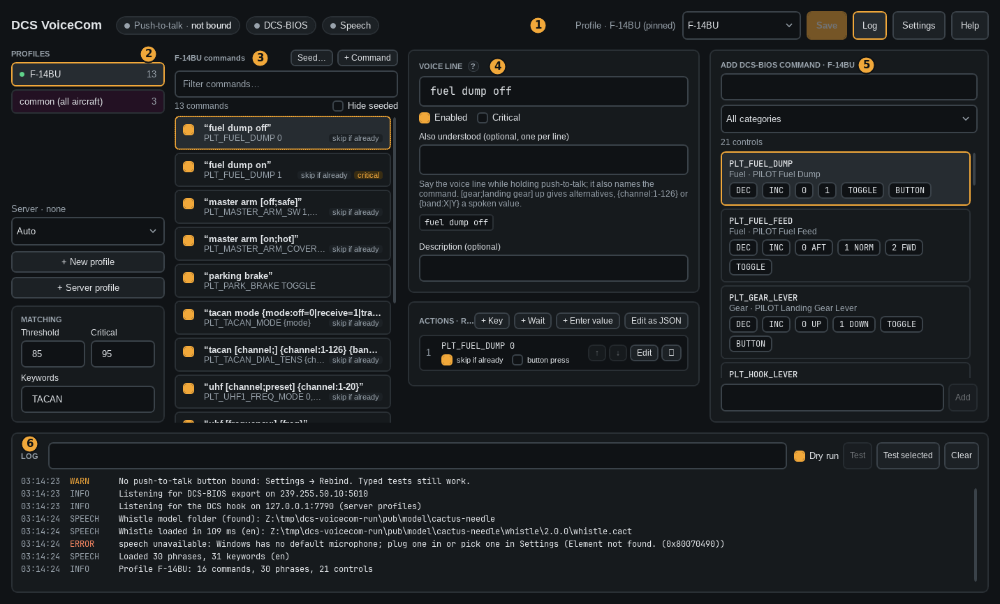

# The main window

1. **Status bar.** The push-to-talk button, DCS-BIOS and speech. A green dot means working: listening,
   DCS connected, speech ready. Hover a dot for details. On the right: the active profile, Save (Ctrl+S),
   Log, Settings and Help. On a narrow window the status text gets shorter; the buttons always stay.
2. **Profiles.** One per aircraft, [server profiles](11-server-profiles.md), and *common* for every aircraft.
   The active ones have a green dot. Common and server profiles are purple and always listed below the aircraft. Below the list: the multiplayer server you're on, and the server profile pin.
   Variants of one jet share a profile: an F-16D_52 uses the F-16C_50 profile, unless it has its own.
   The F-14A, F-14B, F-14B(U) and Mirage F1CE, F1EE, F1BE each get their own.
   *Matching* below the list sets the scores a command needs and the keywords.
3. **Commands.** All commands of the profile, sorted A–Z by voice line. Tick a box to enable a command. Right-click for duplicate and delete.
4. **Editor.** The voice line and the actions of the selected command.
5. **Add DCS-BIOS command.** Search the aircraft's switches and click a value to add it as an action.
6. **Log.** What was heard, the match, and what was sent. Type a phrase here to test it.

Minimizing hides the window in the tray. The tray menu pins a profile or quits.
