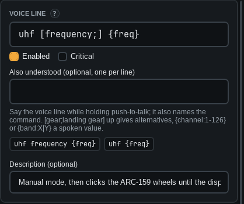

# Writing phrases

The voice line is what you say. Case and punctuation do not matter.

| Write | Means |
|---|---|
| `gear up` | Say exactly this. |
| `[gear;landing gear] up` | Say either one: "gear up" or "landing gear up". |
| `[please;] gear up` | "please" is optional. |
| `channel {channel:1-126}` | A spoken number from 1 to 126. |
| `uhf {freq}` | A frequency: "two five one decimal zero". |

For one of a few words, list them: `tacan band {band:X|Y}`. Say "x-ray" for X.

Put more ways to say it under *Also understood*, one per line. The grey chips under the box show every phrase
the line expands to. Problems show in red.

> **Tip:** Keep phrases of different commands clearly different. "gear up" and "gear down" differ in one word,
> so say that word clearly.
