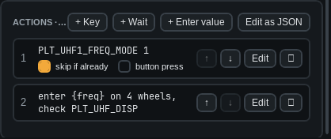

# Actions and steps

Actions run in order, top to bottom, when the command is recognised.

- **DCS-BIOS step.** Sets a cockpit control. Add one from the *Add DCS-BIOS command* panel.
  *skip if already* does nothing when the switch is already there.
- **Button press.** Tick *button press* to push, hold and release (default 50 ms).
- **+ Key.** Presses a key combination, such as `RCtrl+G`. DCS must have focus.
- **+ Wait.** Waits a number of milliseconds.
- **+ Enter value.** Dials a spoken number into a radio. See [Enter value](06-enter-value.md).
- **Edit as JSON.** For conditions and waits on cockpit state.

Use ↑ ↓ to reorder. Double-click a step to edit it.

> **Tip:** Tick *Dry run* in the Log to see the steps without sending them.
