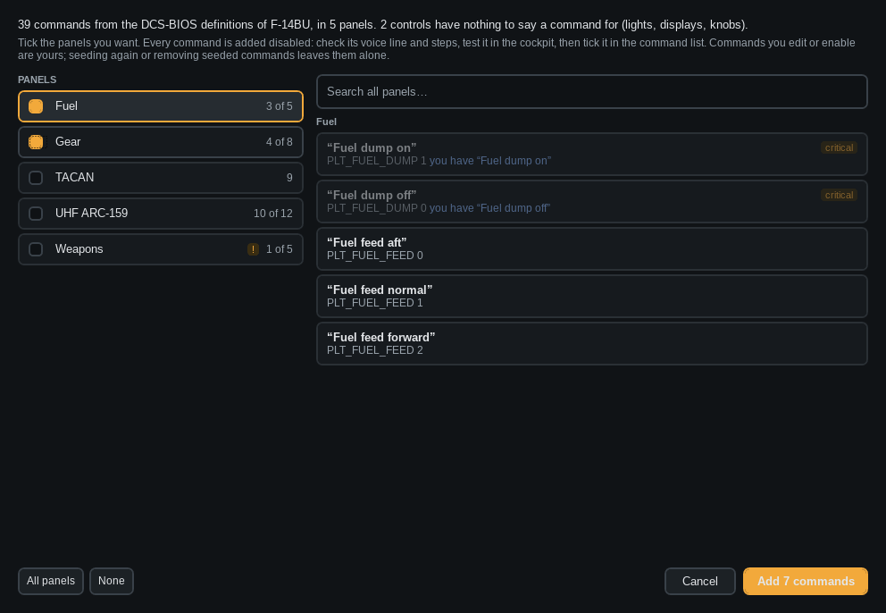

# Seeding commands

**Seed…** above the command list makes starter commands from the aircraft's DCS-BIOS controls. You don't
have to type them all yourself.

1. Tick the cockpit panels you want.
2. Look through the preview. Grey lines are already covered by your own commands.
3. Click **Add**.

Seeded commands start **disabled**. Check the voice line, test it, then tick it. Once you edit or enable a
command it is yours. Seeding again never changes it.

*Hide seeded* hides the ones you have not checked yet. Right-click → *Remove seeded commands* removes them.
