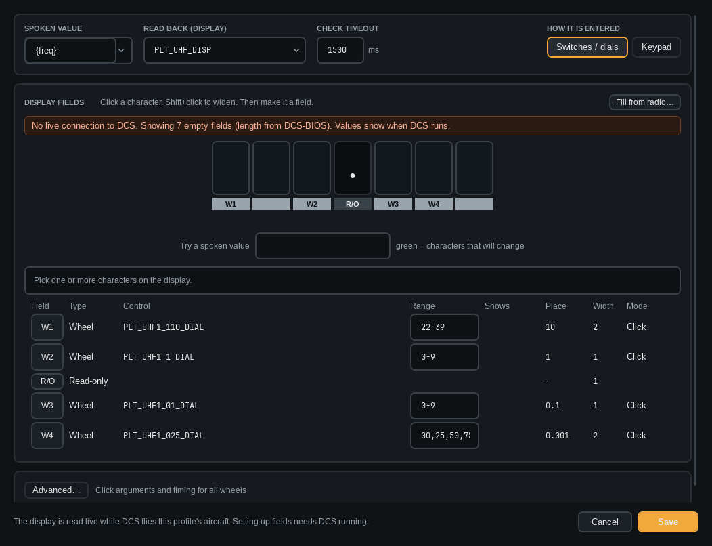

# Enter value

An *Enter value* step puts a spoken number or text into the cockpit: a frequency on radio wheels, or text
on a keypad. Add it with **+ Enter value**, then click **Edit**. DCS must be running to set it up.

1. Pick the spoken **value** (the slot, for example `{freq}`) and the **display** that shows it.
2. Choose *Switches / dials* or *Keypad*.
3. Click characters on the display (Shift+click to widen) and make each part a *Wheel*, the *Keypad* field
   or *Read-only*.
4. For a wheel, pick its control and range (`0-9`, `22-39`, `X,Y`). ▲ / ▼ send one test click.

*Fill from radio…* finds a radio's wheels from their names.
*Learn from display…* works it out from the live display instead (DCS must be running): tick the controls to try, press
**Start**, and the app turns each knob or presses each key once, sees what changes and fills in the fields and ranges.
It puts knobs back and clears the entry afterwards. **Cancel** does the same. Check the result before saving.

> **Tip:** Learn only runs when you press the button. Power, arm, fire and ENT-type controls are never touched.

*Try a spoken value* shows what each character will become.
