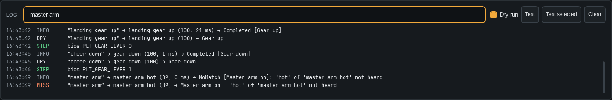

# How matching works

1. You hold push-to-talk and speak. The app keeps 200 ms from before the press, so the first word is not cut.
2. **Whistle**, the speech engine, turns the clip into text. It runs on your PC, nothing goes online.
   It gets the profile's phrase words and keywords as hints.
3. The app compares the text with every phrase. It scores spelling and sound, so "cheer down" still finds
   "gear down".
4. The best phrase runs if its score reaches the **threshold** (85, or 95 for critical commands).

A command is refused when:

- a word of the phrase was **not heard**, or
- two commands are **too close to call** and the words that tell them apart were unclear.

> **Tip:** Add a word to *Keywords* only when Whistle keeps getting it wrong, such as "TACAN".
