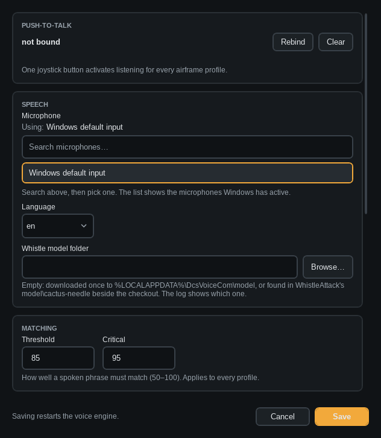

# Settings

- **Push-to-talk.** *Rebind*, then press a HOTAS button within 15 seconds. One button for every aircraft.
- **Speech.** Microphone, language and the Whistle model folder. Leave the folder empty to use the built-in model.
- **Matching.** The score a command needs (85) and a critical command needs (95), 50 to 100. For every profile.
- **DCS-BIOS connection.** Host, ports and the folder with the aircraft definitions. The defaults fit a normal
  install.
- **DCS hook.** *Install* puts a small script into `Saved Games\DCS\Scripts\Hooks`. It tells the app which
  multiplayer server you're on, for [server profiles](11-server-profiles.md). *Remove* takes it out again.
- **Profiles and keys.** Where the profile files are kept, how long a key is held, and the sounds for accepted,
  no match and refused.

Saving restarts the voice engine. All settings are in `%LOCALAPPDATA%\DcsVoiceCom\settings.json`.
